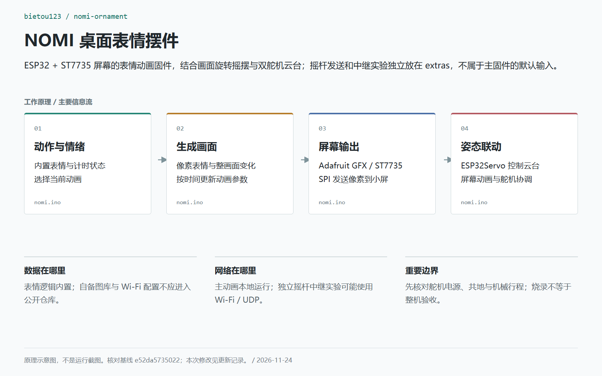
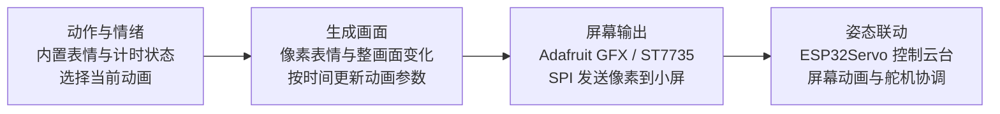

# NOMI 桌面表情摆件

ESP32 + ST7735 屏幕的表情动画固件，结合画面旋转摇摆与双舵机云台；摇杆发送和中继实验独立放在 extras，不属于主固件的默认输入。

**适合谁：** 想理解小屏逐帧动画、SPI 输出与舵机姿态联动的电子制作爱好者。

## 一图看懂

上图是依据公开源码绘制的原理示意，不是运行截图；以下表格与文字提供相同信息，便于小屏阅读。

## 主链路与源码

| 步骤 | 做了什么 | 代码或说明入口 |
| --- | --- | --- |
| 1. 动作与情绪 | 内置表情与计时状态；选择当前动画 | [src/nomi.ino](../src/nomi.ino) |
| 2. 生成画面 | 像素表情与整画面变化；按时间更新动画参数 | [src/nomi.ino](../src/nomi.ino) |
| 3. 屏幕输出 | Adafruit GFX / ST7735；SPI 发送像素到小屏 | [src/nomi.ino](../src/nomi.ino) |
| 4. 姿态联动 | ESP32Servo 控制云台；屏幕动画与舵机协调 | [src/nomi.ino](../src/nomi.ino) |

## 关键原理

### 表情由参数与绘制组成

固件在本机选择情绪、更新动画相位，再绘制到 ST7735。画面旋转摇摆属于像素和时间参数变化，不需要云端生成图片，也不接入大模型情绪识别。

对应入口：[src/nomi.ino](../src/nomi.ino)。

### 舵机是独立输出通道

屏幕通过 SPI 输出，舵机通过 ESP32Servo 产生控制脉冲。动作上可以协调，但电源瞬态和机械限位必须独立考虑，软件动画流畅不代表云台不会堵转。

对应入口：[platformio.ini](../platformio.ini)。

### 附录实验不是成品能力

extras 分别包含摇杆发送端与串口 / UDP 中继，主固件没有把它们自动接入。品牌图片缺失时显示占位；公开代码许可不覆盖未提供的品牌图或角色形象。

对应入口：[extras](../extras)。

## 数据与安全边界

| 范围 | 说明 |
| --- | --- |
| 数据 | 表情逻辑内置；自备图库与 Wi-Fi 配置不应进入公开仓库。 |
| 网络 | 主动画本地运行；独立摇杆中继实验可能使用 Wi-Fi / UDP。 |
| 重要边界 | 先核对舵机电源、共地与机械行程；烧录不等于整机验收。 |

## 运行与复现

安装 PlatformIO 后在仓库根目录执行 pio run 仅编译。接线、串口与烧录注意事项按主 README 独立核对。

本次为图文原理整理，没有执行设备动作、系统切换或付费请求。已有验收范围与运行条件以主 README 和相关报告为准。

## 已知限制

- 屏幕批次可能需要不同初始化与行偏移设置。
- 时间显示不是可靠 RTC；舵机启动电流可能影响屏幕与控制器。

## 本次更新

2026-11-24：新增项目专属原理图、源码入口、运行条件与边界说明。本项目本轮没有修改功能，也没有扩大既有实测结论。

## 可编辑流程图

下面的 Mermaid 与上方 PNG 表达同一主链路，便于后续维护：

[返回项目 README](../README.md)

源码核对基线：[e52da5735022](https://github.com/bietou123/nomi-ornament/tree/e52da5735022c6687ea2f501e96b029cc8fb76c2)，并结合本次更新中列明的改动。
